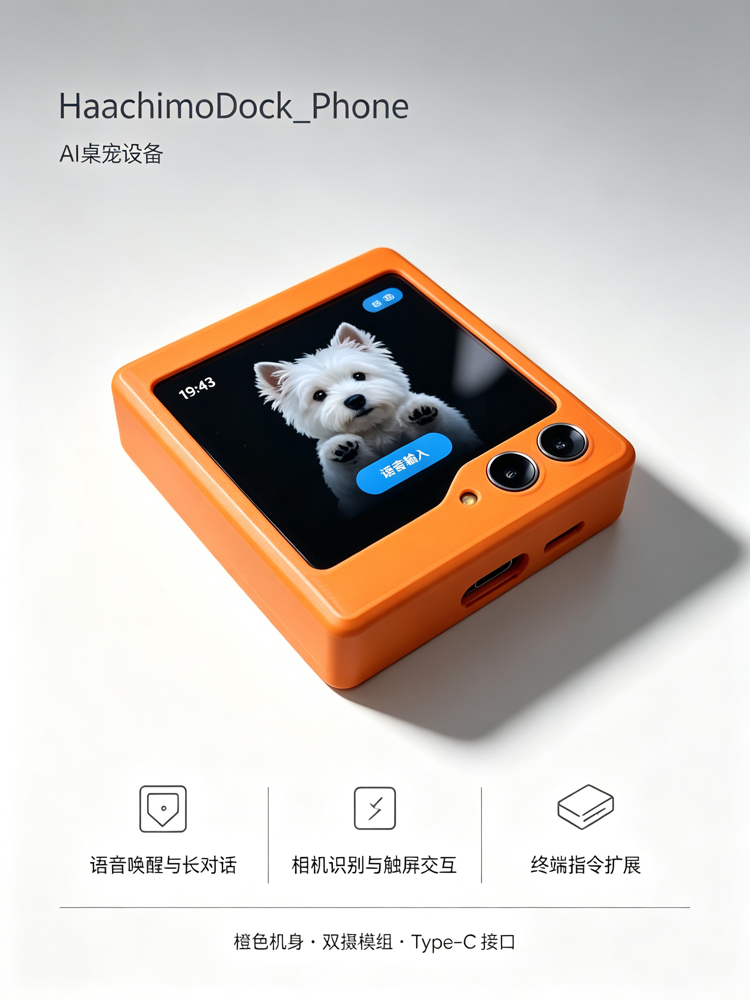
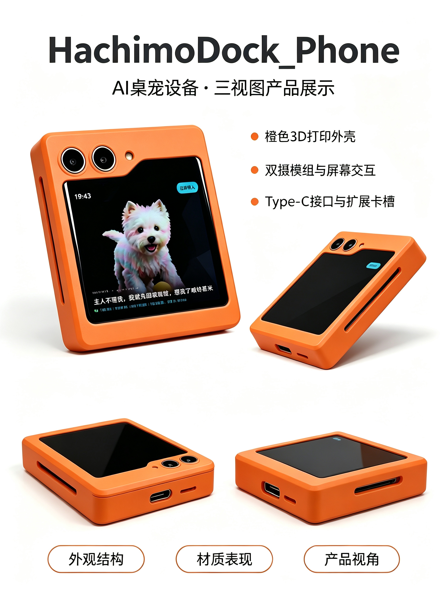

<div align="center">

# HachimoDock_Phone

**把折叠屏手机变成你的 AI 桌宠 & Agent 状态伴侣**

[-3DDC84?logo=android&logoColor=white)](android/hachimo)
[](#兼容与许可)
[](bridge/src/server.mjs)
[](esp32/servo_control)

<p align="center">
  
</p>

</div>

---

## 简介

**HachimoDock_Phone** 将 [HachimoDock](https://github.com/ai-maker-lab/HachimoDock) 的桌面终端形态迁移到折叠屏手机（以三星 Galaxy Z Flip5 为主调试机，兼容主流 Android 7.0+ 机型）：

- **纯手机即可 0 成本闭环**：内置端侧 `sherpa-onnx` FP16 唤醒词（「哈基米」）与本地中文 VITS 童声，搭配免费云端 ASR / LLM / VLM 或本机小模型，不接电脑也能独立语音对话与看图。
- **电脑 Agent 外屏伴侣**：通过零依赖 Node.js Bridge，实时把 **Claude Code / Codex / Trae** 的思考、工具执行、等待确认与回复回显到手机外屏，并支持外屏点击确认与语音下发指令。
- **可选桌面云台随动**：支持 CameraX + ML Kit 姿态/人脸记忆，通过 Type-C OTG 串口驱动 **ESP32-C3 + SG90** 双轴云台自动跟踪。

---

## 核心特性

| 模块 | 能力说明 |
|---|---|
| **外屏桌宠交互** | 合盖自动上外屏（`SYSTEM_ALERT_WINDOW` + 折痕传感器），动态切换状态动画与音效，支持倒立 180° 自动跟随与外屏桌面小组件 |
| **端侧 KWS + 连续对话** | `sherpa-onnx` FP16 端侧唤醒 + 去直流/自动增益/滑窗增强；免费方案自动全兜底保唤醒率，付费方案智能分级截断长闲聊 |
| **免费 / 付费双方案** | **免费版**：硅基流动免费 ASR + `Qwen/Qwen3-8B`（或智谱 `glm-4-flash` / 本地 Ollama）+ 本机离线 5 音色童声<br>**付费版**：阿里云 `qwen3-asr-flash` + `CosyVoice` + `DeepSeek` |
| **按需语义看图** | 摄像头默认关闭；仅命中视觉线索且对话模型判定需要看现场画面（`[CAM]`）时临时抓拍 1 帧，交智谱免费 `glm-4v-flash` 问答 |
| **PC Bridge 多端采集** | 零 npm 依赖（Node ≥ 18），支持 UDP 局域网自动发现、常量时间令牌鉴权、Beacon 指纹防劫持与多 Agent 状态隔离 |
| **USB 串口双轴云台** | 手机通过 Type-C OTG 直连 ESP32-C3（115200 8N1），输出归一化坐标 `P<x>,<y>` 驱动水平/俯仰舵机平滑跟随 |

---

## 产品外观与结构视图

<p align="center">
  
</p>

---

## 系统架构

```text
                ┌────────────────────────────────────────────────────┐
                │                 PC 端 (可选联动)                     │
                │  Claude Hooks / Codex / Trae ─▶ Node Bridge (:8765) │
                └─────────────────────────▲──────────────────────────┘
                                          │ Wi-Fi (WebSocket + UDP Beacon :8767)
                                          ▼
┌─────────────────────────────────────────────────────────────────────────────┐
│                         手机端 (HachimoPhone App)                             │
│  ┌─────────────┐   ┌──────────────────┐   ┌───────────────────────────────┐ │
│  │ 端侧 KWS     │──▶│ 免费 / 付费 ASR   │──▶│ LLM 对话 + [CAM] 语义看图路由  │ │
│  │ (FP16 ONNX) │   │ (硅基 / 阿里云)   │   │ (Qwen3-8B / GLM / DeepSeek)   │ │
│  └─────────────┘   └──────────────────┘   └───────────────┬───────────────┘ │
│                                                           ▼                 │
│  ┌─────────────┐   ┌──────────────────┐   ┌───────────────────────────────┐ │
│  │ 外屏桌宠 UI  │◀──│ 离线 VITS 童声    │   │ CameraX + ML Kit / ArcFace    │ │
│  │ (Display 1) │   │ (5 音色 / 系统TTS) │   └───────────────┬───────────────┘ │
│  └─────────────┘   └──────────────────┘                   │ USB OTG CDC     │
└───────────────────────────────────────────────────────────┼─────────────────┘
                                                            ▼
                                             ESP32-C3 + SG90 双轴云台
```

---

## 快速开始

### 1. 构建并安装手机端

环境要求：JDK 17、Android SDK 34。

```bash
cd android
./gradlew :hachimo:assembleDebug
adb install -r hachimo/build/outputs/apk/debug/hachimo-debug.apk
```

### 2. 配置手机端（纯手机模式可跳过第 3 步）

1. 打开 **HachimoPhone** 控制台，选择 **「免费 (硅基+本机)」** 或 **「付费 (阿里+DeepSeek)」**。
2. 填入对应 API Key（纯免费对话与识别仅需 1 个硅基流动 Key；如需看图问答，补充智谱免费 Key 即可；本机 Ollama 等局域网小模型免 Key）。
3. 点击 **「保存语音与模型配置」**；如使用折叠屏合盖自启，点 **「开启外屏常驻」** 授予悬浮窗权限，再点 **「打开外屏展示页」**。

### 3. 启动 PC Bridge（可选，联动电脑 Agent）

环境要求：Node.js ≥ 18（自检测试脚本需 Node ≥ 22）。

```bash
node bridge/start-all.mjs
```

- 首次启动会在 `bridge/token.txt` 生成配对令牌，填入手机端「配对令牌」即可（地址留空自动局域网发现）。
- 仅运行调试联调：

```bash
MOCK=1 node bridge/src/server.mjs
node bridge/test/client.mjs
```

### 4. 刷入 ESP32-C3 云台固件（可选）

使用 PlatformIO 打开 `esp32/servo_control/` 编译烧录至 ESP32-C3（水平舵机接 `GPIO4`，俯仰接 `GPIO5`，舵机需独立 5V 供电并与开发板共地）。

---

## 目录结构

```text
HachimoDock_Phone/
├── android/
│   ├── hachimo/            # Android 独立应用模块（外屏 UI、KWS、离线 TTS、视觉/串口）
│   ├── gradlew*            # 自带 Gradle 8.7 Wrapper
│   └── settings.gradle
├── bridge/
│   ├── src/server.mjs      # 零依赖 WebSocket + HTTP Bridge
│   ├── hooks/              # Claude Code / Codex / Trae 状态采集
│   ├── asr/                # Windows System.Speech 离线兜底脚本
│   └── launcher/           # Windows C# 单文件启动器源码
├── esp32/servo_control/    # ESP32-C3 SG90 双轴舵机控制固件
├── assets/                 # 产品海报、三视图渲染与试听音频
└── docs/                   # 设计文档与 Galaxy Z Flip5 实机适配笔记
```

---

## 兼容与许可

- **设备兼容范围**：`Android 7.0+`（`minSdk 24`）、`arm64-v8a` 设备，已完成 Android 16 **16 KB 页对齐**适配；非折叠屏手机自动降级在主屏运行。
- **素材与开源协议注意**：`android/hachimo/src/main/assets/terrier/` 下的宠物视频与部分提示音来自上游 [HachimoDock](https://github.com/ai-maker-lab/HachimoDock) 的非商业源码可见素材（详见 `UPSTREAM-LICENSE.txt`），**公开二次分发或商用前请替换为自有素材**。
- **详细开发与踩坑记录**：见 [docs/hachimodock-phone-plan.md](docs/hachimodock-phone-plan.md)、[docs/cover-screen-adaptation.md](docs/cover-screen-adaptation.md)、[docs/device-galaxy-z-flip5.md](docs/device-galaxy-z-flip5.md)。
