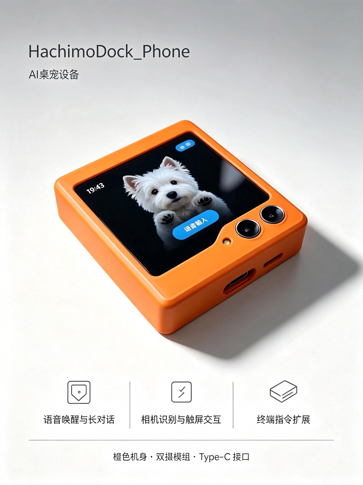
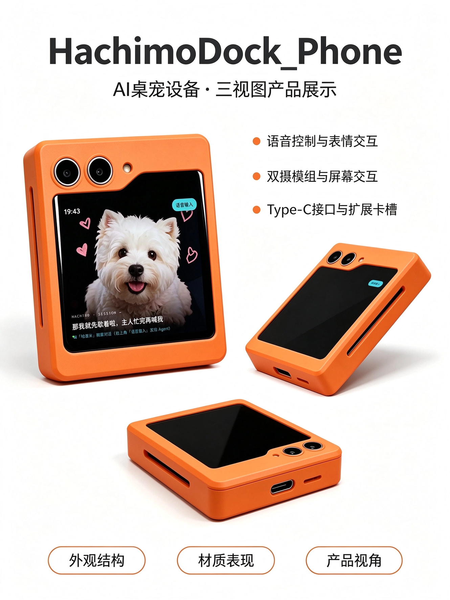

<div align="center">

# HachimoDock\_Phone

**把手机变成你的 AI 桌宠 & Agent 状态终端**

[-3DDC84?logo=android\&logoColor=white)](android/hachimo)
[](#兼容与许可)
[](bridge/src/server.mjs)
[](esp32/servo_control)

<p align="center">
  
</p>

</div>

***

## 简介

**HachimoDock\_Phone** 将 [HachimoDock](https://github.com/ai-maker-lab/HachimoDock) 的桌面终端形态迁移到Android系统手机，兼容主流 Android 7.0+ 机型）：

- **纯手机即可 0 成本闭环**：内置端侧唤醒词（「哈基米」）与本地童声语音交互，搭配免费云端 ASR / LLM / VLM 或本机小模型，不接电脑也能独立语音对话与看图。
- **电脑 Agent 伴侣**：通过零依赖 Node.js Bridge，实时把 **Claude Code / Codex / Trae / WorkBuddy** 的思考、工具执行、等待确认与回复回显到手机屏幕，并支持屏幕点击确认与语音下发指令。
- **可选桌面云台随动**：支持 CameraX + ML Kit 姿态/人脸记忆，通过 Type-C OTG 串口驱动 **ESP32-C3 + SG90** 双轴云台自动跟踪。

***

## 核心特性

| 模块                 | 能力说明                                                                                                                                                                                                          |
| ------------------ | ------------------------------------------------------------------------------------------------------------------------------------------------------------------------------------------------------------- |
| **屏幕桌宠交互**         | 手机内外屏均可交互，对折叠屏手机进行了专项优化，合盖自动上外屏（`SYSTEM_ALERT_WINDOW` + 折痕传感器），动态切换状态动画与音效，支持 180° 自动人体跟随与10余组桌面宠物表情包（含宠物声音）                                                                                                  |
| **端侧 KWS + 连续对话**  | 端侧VAD + 唤醒 + 去直流/自动增益/滑窗增强；AI对话功能有免费方案和付费方案可选，做到0门槛上手与极致体验的双重保障                                                                                                                                               |
| **免费 / 付费双方案**     | **免费版**：智谱 `glm-4-flash` 对话 + `glm-4v-flash` 看图；可选阿里云每月重置免费的 `paraformer-realtime-v2` 识别 + `sambert-zhiying-v1` 语音，留空用本机离线童声（也兼容硅基流动 / 本地 Ollama）<br>**付费版**：阿里云 `qwen3-asr-flash` + `CosyVoice` + `DeepSeek` |
| **按需语义看图**         | 摄像头默认关闭；命中视觉线索且对话模型判定需要看现场画面时，自动打开摄像头捕捉画面上传vlm模型进行场景理解                                                                                                                                                        |
| **PC Bridge 多端采集** | 零 npm 依赖（Node ≥ 18），支持 Claude Code / Codex / Trae / WorkBuddy 状态采集、UDP 局域网自动发现、常量时间令牌鉴权、Beacon 指纹防劫持与多 Agent 状态隔离                                                                                             |
| **USB 串口双轴云台**     | 手机通过 Type-C OTG 直连 ESP32-C3（115200 8N1），输出归一化坐标 `P<x>,<y>` 驱动水平/俯仰舵机平滑跟随                                                                                                                                      |

***

## 产品外观与结构视图

<p align="center">
  
</p>

***

## 系统架构

```text
              ┌────────────────────────────────────────────────┐
              │                PC 端 (可选联动)                 │
              │  Claude / Codex / Trae / WorkBuddy -> Bridge   │
              └───────────────────────┬────────────────────────┘
                                      ^  
                          Wi-Fi (WebSocket + UDP :8767)
                                      v
┌────────────────────────────────────────────────────────────────────────────┐
│                         手机端 (HachimoPhone App)                           │
│ ┌────────────────┐   ┌──────────────────┐    ┌────────────────────────────┐ │
│ │ 端侧 KWS 唤醒   │   │ 免费 / 付费 ASR   │   │   LLM 对话 + [CAM] 路由     │ │
│ │  (FP16 ONNX)   │-->│ (硅基 / 阿里云)   │--> │  (Qwen3 / GLM / DeepSeek)  │ │
│ └────────────────┘   └──────────────────┘    └─────────────┬──────────────┘ │
│                                                            v                │
│ ┌────────────────┐   ┌──────────────────┐    ┌─────────────┴──────────────┐ │
│ │  外屏桌宠 UI   │    │  离线 VITS 童声  │    │ CameraX + ML Kit / ArcFace │ │
│ │  (Display 1)   │<--│ (5 音色/系统TTS) │    └─────────────┬──────────────┘ │
│ └────────────────┘   └──────────────────┘                 │ USB OTG CDC    │
└───────────────────────────────────────────────────────────┼────────────────┘
                                                            v
                                              ┌──────────────────────────────┐
                                              │   ESP32-C3 + SG90 双轴云台    │
                                              └──────────────────────────────┘
```

***

## 快速开始

### 1. 构建并安装手机端

环境要求：JDK 17、Android SDK 34。

```bash
cd android
# 打包当前唯一版本 v1.1.0-lite（含 KWS 唤醒、离线童声、VLM 语义看图、系统人脸云台追踪、小智模式与 Bridge）
./gradlew :hachimo:assembleRelease
adb install -r hachimo/build/outputs/apk/release/hachimo-release.apk
```

### 2. 配置手机端（第2-4步任选一种模式即可）

1. 打开 **HachimoPhone** 控制台，选择 **「免费(智谱)」**、**「付费(阿里)」** 或 **「小智模式」**。
2. **免费(智谱)**：填 **智谱 Key**（永久免费高并发 `glm-4-flash-250414` 对话 + `glm-4v-flash` 看图，遇 429 自动容灾切换）与可选 **阿里云 Key**（每月 1 日重置长期免费的 `paraformer-realtime-v2` 识别 + `sambert-zhiying-v1` 语音；留空用本机离线童声；若用百炼新版 `sk-ws-` 密钥，请在下方填入控制台右上角的 **Workspace ID** 如 `llm-xxx`）。
3. **付费(阿里)**：填 1 个 **阿里云 DashScope Key**（极简低价 `qwen3.7-flash` 0.2/0.8元/百万Token 对话看图 + `qwen3-asr-flash` / `cosyvoice-v3-flash`，无额度时自动回退免费 `paraformer` 与 `sambert`；`sk-ws-` 密钥同步填 **Workspace ID**）。
4. **小智模式（兼容自建后端）**：**OTA 地址**默认使用官方 `https://api.tenclass.net/xiaozhi/ota/`，也可以改成个人自建 [`xiaozhi-esp32-server`](https://github.com/xinnan-tech/xiaozhi-esp32-server) 或授权小智服务端的地址；点击 **「获取激活码 / 测试连通」** 完成设备绑定即可走 Opus 双向流式语音对话。设备身份由 Android ID 派生，覆盖安装或重装都不会更换激活码；需要重置时按钮会自动在「换新设备码 / 恢复默认设备码」之间切换。
5. 点击 **「保存语音与模型配置」**（也可点击 **「试听」** 实时验证本机/云端/系统 TTS）；如使用折叠屏合盖自启，点 **「开启外屏常驻」** 授予悬浮窗权限，再点 **「打开外屏展示页」**。

### 3. 启动 PC Bridge（可选，联动电脑 Agent）

环境要求：Node.js ≥ 18（自检测试脚本需 Node ≥ 22）。

```bash
node bridge/start-all.mjs
```

- 首次启动会在 `bridge/token.txt` 生成配对令牌，填入手机端「配对令牌」即可（地址留空自动局域网发现）。
- 同时会自动安装/刷新 Claude Code 与 WorkBuddy 的状态 hooks：WorkBuddy 需先启动过一次（默认读 `~/.workbuddy/settings.json`，可用 `WORKBUDDY_CONFIG_DIR` 覆盖；未安装时自动跳过，开启 `disableAllHooks` 时不改动用户配置）。
- 仅运行调试联调：

```bash
MOCK=1 node bridge/src/server.mjs
node bridge/test/client.mjs
```

### 4. 刷入 ESP32-C3 云台固件（可选）

使用 PlatformIO 打开 `esp32/servo_control/` 编译烧录至 ESP32-C3（水平舵机接 `GPIO5`，俯仰接 `GPIO4`，当前只接水平舵机也能用；舵机需独立 5V 供电并与开发板共地）。

***

## 3D 打印外壳

`hardware/model/v1.1.0/` 提供 v1.1.0 版手机外壳的 STL 模型（适配三星 Galaxy Z Flip5），可直接导入 Bambu Studio / Cura / OrcaSlicer 等切片软件：

| 文件                                | 用途     |
| --------------------------------- | ------ |
| `galaxy-z-flip5-shell.stl`        | 主机外壳主体 |
| `galaxy-z-flip5-back-bracket.stl` | 后盖相册支架 |
| `galaxy-z-flip5-back-leg.stl`     | 相册支腿   |

> STL 只包含几何模型，不含打印参数；请在切片软件中确认尺寸、摆放方向与支撑设置，模型细节以仓库中的最新版本为准。

***

## 目录结构

```text
HachimoDock_Phone/
├── android/
│   ├── hachimo/            # Android 独立应用模块（外屏 UI、KWS、离线 TTS、视觉/串口）
│   ├── gradlew*            # 自带 Gradle 8.7 Wrapper
│   └── settings.gradle
├── bridge/
│   ├── src/server.mjs      # 零依赖 WebSocket + HTTP Bridge
│   ├── hooks/              # Claude Code / Codex / Trae / WorkBuddy 状态采集
│   ├── asr/                # Windows System.Speech 离线兜底脚本
│   └── launcher/           # Windows C# 单文件启动器源码
├── esp32/servo_control/    # ESP32-C3 SG90 双轴舵机控制固件
├── hardware/model/v1.1.0/  # 3D 打印外壳 STL（外壳主体 + 相册支架 + 支腿）
└── assets/                 # 产品海报、三视图渲染与试听音频
```

***

## 支持机型与兼容说明

| 手机品牌             | 已测机型                                       | 适配状态    | 运行说明                                                                    |
| ---------------- | ------------------------------------------ | ------- | ----------------------------------------------------------------------- |
| **华为 (Huawei)**  | **Huawei Mate50、Mate60 系列（CET-AL00）、荣耀20** | ✅ 已测试支持 | 直板机自动在主屏完整运行语音、看图与云台功能                                                  |
| **三星 (Samsung)** | **三星 flip z50**                            | ✅ 已测试支持 | 折叠屏支持外屏桌宠展示、合盖自启与外屏桌面小组件                                                |
| **小米 (Xiaomi)**  | **小米 15 Pro**                              | ✅ 已测试支持 | 直板机自动在主屏完整运行                                                            |
| **其它品牌**         | 其他 Android 机型                              | 🟡 理论支持 | 满足 `Android 7.0+`（`minSdk 24`）且 `arm64-v8a` 架构理论上均可正常使用；如遇个别机型问题会持续更新适配 |

***

## 兼容与许可

- **设备兼容范围**：`Android 7.0+`（`minSdk 24`）、`arm64-v8a` 设备，非折叠屏手机自动降级在主屏运行。
- **素材与开源协议注意**：`android/hachimo/src/main/assets/terrier/` 下的宠物视频与部分提示音来自上游 [HachimoDock](https://github.com/ai-maker-lab/HachimoDock) 的非商业源码可见素材（详见 `UPSTREAM-LICENSE.txt`），**公开二次分发或商用前请替换为自有素材**。
- **端侧模型**：`android/hachimo/src/main/assets/movenet_lightning_int8.tflite` 为 Google MoveNet SinglePose Lightning（int8，来自 Kaggle Models `google/movenet`），Apache License 2.0；TensorFlow Lite 运行时同为 Apache 2.0。
